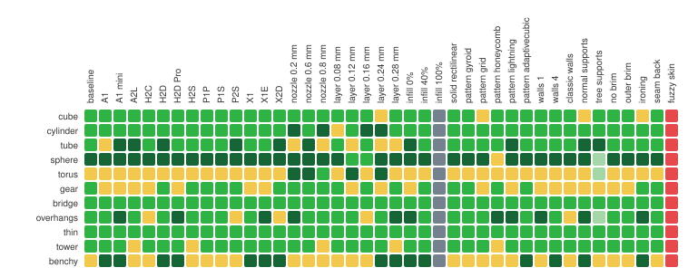

# Equivalence report

Does Pandy Studio's phone slicer write the same G-code as the official Bambu Studio? Each cell below is one
plate sliced on a phone and by the official Bambu Studio, compared as described in
[equivalence/README.md](../../equivalence/README.md). Regenerate with `equivalence/matrix.py run` and `report`.

*Generated 2026-11-08 14:03 UTC.*

| | |
|---|---|
| 🟩 **1:1** | the phone's G-code is byte-identical to an output of the official build, or within the official build's own run-to-run variation |
| 🟨 **Part 1:1, supports differ** | the part's walls are identical; only supports and the layers resting on them differ |
| 🟥 **Differs** | the part differs beyond the official build's own variation |
| ⬜ **Not verified** | not run yet |

**351 green · 2 yellow · 47 red · 0 not verified** (of 400: 10 models × 40 configurations)

Hover a cell (open the SVG) for its details. Columns change one thing from the baseline: X1 Carbon, 0.4 mm nozzle,
0.20mm Standard @BBL X1C, Bambu PLA Basic; printer columns use that printer's own default process and PLA.

## What was compared

| | |
|---|---|
| Official build | Bambu Studio 02.08.02.61 Linux AppImage (SHA-256 pinned in Pandy Slicer's Dockerfile), x86-64, Docker image `sha256:b9e97e25dc56` |
| Phone engine | `pandy-engine` arm64, SHA-256 `729b7ad33821c458bc60b3db6822663ad6ffc58b17501c86641aefb38760af00` |
| Profiles | the official release's `resources/`, tree SHA-256 `208e794164f68830cf50f27711d0ae91c7371d64f96c984bdb6daea732a2b175` (3889 files) |
| Compiler | GCC 13.3.0 (Ubuntu 24.04), both builds |
| C library | glibc 2.39 (Ubuntu 24.04), static on the phone |
| Maths functions | arm64 glibc, except `hypot`, `cbrt`, `pow`, `tanf`, `asinf`, `acosf`, `atanf`, `atan2f`: glibc 2.39's source compiled as x86-64 compiles it ([engine/x86-libm](../../engine/x86-libm/README.md)); bit-identical to x86-64 on 2M inputs each |
| Phone | Sony Xperia 10 IV (XQ-CC54), Android 14, Snapdragon 695 |
| Runs | each cell: 5 official runs (the official build varies from run to run), 1 phone run; all pinned to one CPU |

Models are generated (`equivalence/pandy_equiv/models.py`): cube 20 mm, cylinder, tube (hole), sphere, torus, gear,
bridge (32 mm span), overhangs (45°/60°/75°), thin walls (0.4–2 mm), tower 80 mm.

## Cells that are not green

| | Model | Configuration | Largest difference | Features | Layers |
|---|---|---|---|---|---|
| 🟥 | cylinder | nozzle 0.2 mm | 1.018 mm | Floating vertical shell, Outer wall | 120–120 |
| 🟥 | gear | A1 | 3.38 mm | Floating vertical shell, Sparse infill | 35–35 |
| 🟥 | gear | A1 mini | 3.38 mm | Floating vertical shell, Sparse infill | 35–35 |
| 🟥 | gear | A2L | 3.38 mm | Floating vertical shell, Sparse infill | 35–35 |
| 🟥 | gear | H2D Pro | 3.38 mm | Floating vertical shell, Sparse infill | 35–35 |
| 🟥 | gear | H2S | 3.38 mm | Floating vertical shell, Sparse infill | 35–35 |
| 🟥 | gear | X1E | 3.38 mm | Floating vertical shell, Sparse infill | 35–35 |
| 🟥 | gear | X2D | 3.38 mm | Floating vertical shell, Sparse infill | 35–35 |
| 🟥 | gear | classic walls | 4.415 mm | Floating vertical shell, Sparse infill | 35–35 |
| 🟥 | gear | infill 40% | 0.333 mm | Floating vertical shell | 35–35 |
| 🟥 | gear | layer 0.12 mm | 3.38 mm | Floating vertical shell, Sparse infill | 35–35 |
| 🟥 | gear | layer 0.16 mm | 3.38 mm | Floating vertical shell, Sparse infill | 35–35 |
| 🟥 | gear | layer 0.24 mm | 3.38 mm | Floating vertical shell, Sparse infill | 35–35 |
| 🟥 | gear | no brim | 3.38 mm | Floating vertical shell, Sparse infill | 35–35 |
| 🟥 | gear | walls 1 | 0.661 mm | Floating vertical shell, Outer wall | 35–35 |
| 🟥 | sphere | H2D | – mm | {"only_one_sliced": true, "candidate": {"returncode": 139, "cli_return_code": nu | – |
| 🟥 | sphere | tree supports | 2.504 mm | Bridge, Brim, Custom, Internal solid infill, Skirt, Sparse infill, Support, Support interface | 0–9 |
| 🟥 | torus | A1 | 0.051 mm | Outer wall | 10–41 |
| 🟥 | torus | A1 mini | 0.051 mm | Outer wall | 10–41 |
| 🟥 | torus | A2L | 0.051 mm | Outer wall | 10–41 |
| 🟥 | torus | H2C | 0.051 mm | Outer wall | 10–41 |
| 🟥 | torus | H2D | 0.051 mm | Outer wall | 10–41 |
| 🟥 | torus | H2D Pro | 0.051 mm | Outer wall | 10–41 |
| 🟥 | torus | H2S | 0.051 mm | Outer wall | 10–41 |
| 🟥 | torus | P1P | 0.051 mm | Outer wall | 10–41 |
| 🟥 | torus | P1S | 0.051 mm | Outer wall | 10–41 |
| 🟥 | torus | P2S | 0.051 mm | Outer wall | 10–41 |
| 🟥 | torus | X1 | 0.051 mm | Outer wall | 10–41 |
| 🟥 | torus | X1E | 0.051 mm | Outer wall | 10–41 |
| 🟥 | torus | X2D | 0.051 mm | Outer wall | 10–41 |
| 🟥 | torus | baseline | 0.051 mm | Outer wall | 10–41 |
| 🟥 | torus | fuzzy skin | inf mm | Sparse infill | 46–46 |
| 🟥 | torus | ironing | 0.051 mm | Outer wall | 10–41 |
| 🟥 | torus | layer 0.08 mm | 0.051 mm | Outer wall | 10–41 |
| 🟥 | torus | layer 0.12 mm | 0.051 mm | Outer wall | 10–41 |
| 🟥 | torus | layer 0.16 mm | 0.051 mm | Outer wall | 10–41 |
| 🟥 | torus | layer 0.24 mm | 0.051 mm | Outer wall | 10–41 |
| 🟥 | torus | layer 0.28 mm | 0.051 mm | Outer wall | 10–41 |
| 🟥 | torus | no brim | 0.051 mm | Outer wall | 10–41 |
| 🟥 | torus | nozzle 0.2 mm | 0.051 mm | Outer wall | 10–41 |
| 🟥 | torus | nozzle 0.6 mm | 0.051 mm | Outer wall | 10–41 |
| 🟥 | torus | nozzle 0.8 mm | 0.051 mm | Outer wall | 10–41 |
| 🟥 | torus | outer brim | 0.051 mm | Outer wall | 10–41 |
| 🟥 | torus | pattern grid | 0.051 mm | Outer wall | 10–41 |
| 🟥 | torus | pattern honeycomb | 0.051 mm | Outer wall | 10–41 |
| 🟥 | torus | pattern lightning | 0.051 mm | Outer wall | 10–41 |
| 🟥 | torus | walls 4 | 0.051 mm | Outer wall | 10–41 |
| 🟨 | overhangs | tree supports | 4.744 mm | Bottom surface, Bridge, Internal solid infill, Skirt, Support | 0–72 |
| 🟨 | torus | tree supports | 0.696 mm | Skirt, Support | 0–1 |

## Known differences

* **Tree supports** take different branch decisions on ARM (a systematic difference still being traced). The part's walls are identical; supports and the layers resting on them differ by up to about 1.5 mm. The app marks tree-supported slices as not verified.
* **NaN signs**: an invalid floating-point operation gives `-nan` on x86-64 and `nan` on ARM (the processors' default). It only shows if a NaN were printed into the G-code.
* **Fuzzy skin** is random in Bambu Studio itself: no two official runs are alike either.
